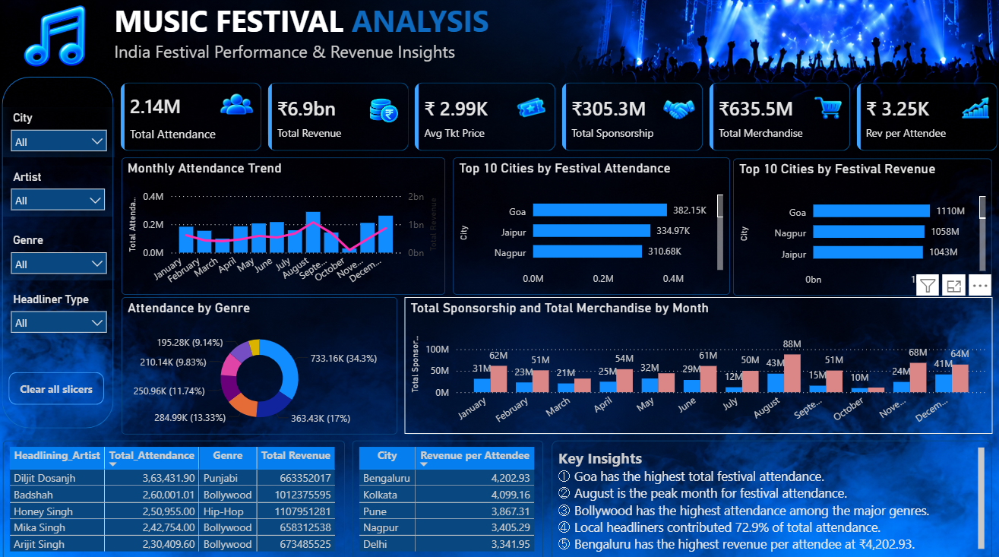

### 🎵 Turning Festival Data into Business Insights

---

## 📌 Project Overview

An end-to-end Data Analyst project based on the Coding Ninjas case study **"Growing Craze of Music Festivals in India"**.

The project analyzes festival attendance, ticket pricing, artist influence, sponsorship, merchandise revenue, and regional revenue efficiency using **Excel and Power BI**.

---

## 🎯 Business Objective

The analysis focuses on answering key business questions:

- Which months and cities have the highest festival demand?
- How does ticket pricing relate to attendance and revenue?
- What is the impact of local vs international headliners?
- How significant are sponsorship and merchandise revenues?
- Which cities offer stronger revenue efficiency for expansion?

---

## 📊 Data

The project uses two datasets:

### Festival Attendance & Revenue
Includes:
- Festival information
- City and date
- Headlining artist
- Ticket price
- Attendance
- Merchandise sales
- Sponsorship revenue
- Total revenue

### Artist Popularity & Engagement
Includes:
- Artist
- Genre
- Average ticket price
- Average attendance
- Social media followers
- Streaming plays
- Merchandise revenue per concert

---

## 🧹 Excel Analysis

Excel was used for:

- Data cleaning and validation
- Missing value handling
- Duplicate removal
- IQR-based outlier detection
- Naming consistency checks
- Attendance trend analysis
- City-wise analysis
- Ticket pricing analysis
- Artist and genre analysis
- Sponsorship and merchandise analysis
- Regional expansion analysis
- PivotTables and PivotCharts
- Business insights and recommendations

### Case Study Stages

1. Data Cleaning & Validation
2. Festival Attendance Trends & Revenue Growth
3. Ticket Pricing Optimization
4. Impact of International vs Local Artists
5. Sponsorship & Merchandise
6. Regional Preferences & Expansion

---

## 📈 Power BI Dashboard

Power BI was used to transform the cleaned data into an interactive dashboard.

### Key Features

- KPI cards
- Interactive slicers
- Monthly attendance and revenue trends
- Top cities by attendance
- Top cities by revenue
- Attendance by genre
- Sponsorship vs merchandise analysis
- Top artists by attendance
- Revenue per attendee by city
- Local vs international headliner analysis
- Key business insights

### Main DAX Measures

- Total Attendance
- Total Revenue
- Average Ticket Price
- Total Sponsorship
- Total Merchandise
- Revenue per Attendee
- Headliner Type

---

## 🔍 Key Insights

- **Goa** recorded the highest total festival attendance.
- **August** was the peak month for festival attendance.
- **Local headliners** contributed approximately **72.9%** of observed attendance.
- **Bollywood** was the most represented major genre.
- **Bengaluru** recorded the highest revenue per attendee at **₹4,202.93**.
- The ticket price–attendance correlation was approximately **0.13**, indicating a very weak positive relationship.

---

## 💡 Business Recommendations

- Prioritize high-demand markets such as Goa, Jaipur and Nagpur.
- Consider Bengaluru, Kolkata and Pune for revenue-focused expansion.
- Continue leveraging strong local headliners while using international artists strategically.
- Use city-specific ticket pricing rather than one universal price.
- Strengthen sponsorship and merchandise monetization.

---

## ⚠️ Data Limitations

- Artist booking cost was not available, so actual artist ROI could not be calculated.
- Ticket-price variations were analyzed as price ranges; the dataset did not specify VIP, early-bird or last-minute tiers.
- Revenue per attendee represents revenue efficiency, not profit.

---

## 🛠️ Tools Used

**Excel | Power BI | DAX | PivotTables | PivotCharts | Data Cleaning | Data Analysis**

---

## 📁 Project Files

This repository contains:

- 📊 Excel analysis workbook
- 📈 Power BI dashboard
- 📑 Project presentation
- 📘 Original Coding Ninjas case study
- 🖼️ Power BI dashboard screenshot
- 🎥 Project walkthrough recording

---

---

<strong>🎶 Thanks for exploring this project!</strong>

  
  

<strong>Made with ❤️ by Akash Das</strong>

